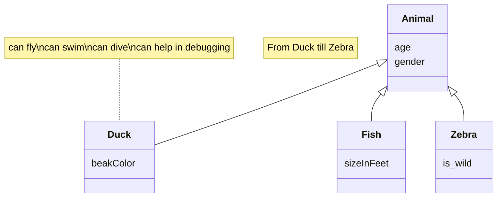

# Documento de análisis de requisitos del sistema

_Esta es una plantilla que sirve como guía para realizar este entregable. Por favor, mantén las mismas secciones y los contenidos que se indican para poder hacer su revisión más ágil._ 

## Introducción

En esta sección debes describir de manera general cual es la funcionalidad del proyecto a rasgos generales. ¿Qué valor puede aportar? ¿Qué objetivos pretendemos alcanzar con su implementación? ¿Cuántos jugadores pueden intervenir en una partida como máximo y como mínimo? ¿Cómo se desarrolla normalmente una partida?¿Cuánto suelen durar?¿Cuando termina la partida?¿Cuantos puntos gana cada jugador o cual es el criterio para elegir al vencedor?

[Enlace al vídeo de explicación de las reglas del juego / partida jugada por el grupo](http://youtube.com)

## Tipos de Usuarios / Roles

< Nombre Rol >: < Breve descripción del rol >

_Ej1: Propietario: Dueño de una o varias mascota que viene a la clínica para mantenerla sana y cuidar de su salud._

_Ej2: Veterinario: Profesional de la salud animal con titulación universitaria homologada, está registrado en la clínica y se encarga de realizar diagnósticos y recetar tratamientos. Además mantiene actualizado el vademécum._

_Ej3: Administrador: Dueño de la clínica que se encarga de dar de alta veterinarios y gestionar la información registrada en la aplicación de la clínica._

## Historias de Usuario

A continuación se definen  todas las historias de usuario a implementar usando la siguiente plantilla:

### HU-(ISSUE#ID): < Nombre > - [Enlace a la Issue asociada a la historia de usuario]()
Descripción de la historia siguiendo el esquema:  "Como <rol> quiero que el sistema <funcionalidad>  para poder <objetivo/beneficio>."
…
Mockup de Interfaz de usuario de la historia
…
Decripción de las interacciones concretas a realizar con la interfaz de usuario del sistema para lleva a cabo la historia. 

_El identificador de cada historia (con el prefijo `HU-`) debe ser el mismo que se use en las anotaciones `@Story` de las pruebas que la verifican: así la matriz de trazabilidad (`D3/Matriz de trazabilidad.md`, generada con `./mvnw verify`) puede relacionarlas y avisar de las historias que no tienen pruebas. El prefijo se puede cambiar en `allurerc.mjs` (`STORY_PREFIX`)._

### HU-01: Iniciar sesión ([Enlace a la Issue asociada a la historia de usuario]())
|Como usuario registrado quiero que el sistema me permita iniciar sesión con mi nombre de usuario y contraseña para poder acceder a las funcionalidades de mi rol.|
|-----|
|_Mockup de la pantalla de inicio de sesión_|
|El usuario abre la pantalla de inicio de sesión, introduce su nombre de usuario y contraseña y confirma. Si las credenciales son correctas accede a la aplicación; si no, se le muestra un mensaje de error.|

### HU-02: Registrarse ([Enlace a la Issue asociada a la historia de usuario]())
|Como visitante quiero que el sistema me permita registrarme como propietario, veterinario o administrador para poder usar la aplicación.|
|-----|
|_Mockup del formulario de registro_|
|El visitante abre el formulario de registro, elige el tipo de usuario, rellena sus datos y confirma. Si el nombre de usuario ya existe se le muestra un error; si no, se crea su cuenta y puede iniciar sesión con ella.|

### HU-03: Gestionar usuarios ([Enlace a la Issue asociada a la historia de usuario]())
|Como administrador quiero que el sistema me permita listar, filtrar por rol, crear, modificar y borrar usuarios para poder mantener las cuentas de la clínica.|
|-----|
|_Mockup del listado y del formulario de usuarios_|
|El administrador abre el listado de usuarios, puede filtrarlo por rol y crear, editar o borrar usuarios. No puede borrar su propia cuenta.|

### HU-04: Gestionar propietarios ([Enlace a la Issue asociada a la historia de usuario]())
|Como administrador quiero que el sistema me permita listar, crear, modificar y borrar propietarios para poder mantener actualizados sus datos.|
|-----|
|_Mockup del listado y del formulario de propietarios_|
|El administrador abre el listado de propietarios y puede crear, editar o borrar propietarios. Los datos obligatorios (nombre, apellidos, dirección, ciudad, teléfono) se validan al guardar.|

### HU-05: Consultar el plan de la clínica ([Enlace a la Issue asociada a la historia de usuario]())
|Como propietario quiero que el sistema me muestre el plan de precios (BASIC, GOLD o PLATINUM) de mi clínica para poder saber qué funcionalidades tengo disponibles.|
|-----|
|_Mockup de la pantalla de plan_|
|El propietario abre la pantalla de su plan y ve sus datos y el plan contratado por su clínica.|

### HU-06: Gestionar mascotas ([Enlace a la Issue asociada a la historia de usuario]())
|Como propietario quiero que el sistema me permita dar de alta, consultar, modificar y borrar mis mascotas para poder llevar su seguimiento en la clínica. El administrador y los veterinarios pueden gestionar las mascotas de todos los propietarios.|
|-----|
|_Mockup del listado y del formulario de mascotas_|
|El propietario abre el listado de sus mascotas y puede añadir, editar o borrar mascotas indicando su nombre, fecha de nacimiento y tipo. No puede tener dos mascotas con el mismo nombre ni superar el número de mascotas de su plan (BASIC: 2, GOLD: 4, PLATINUM: 7). Un propietario no puede ver ni modificar las mascotas de otros.|

### HU-07: Gestionar visitas ([Enlace a la Issue asociada a la historia de usuario]())
|Como propietario quiero que el sistema me permita solicitar, consultar, modificar y cancelar visitas para mis mascotas para poder atenderlas en la clínica. El administrador y los veterinarios pueden gestionar todas las visitas.|
|-----|
|_Mockup del listado y del formulario de visitas_|
|El propietario abre las visitas de una de sus mascotas y puede añadir, editar o borrar visitas indicando fecha, hora, descripción y veterinario. No puede superar el número de visitas mensuales de su plan (BASIC: 1, GOLD: 3, PLATINUM: 6).|

### HU-08: Gestionar veterinarios ([Enlace a la Issue asociada a la historia de usuario]())
|Como administrador quiero que el sistema me permita listar, crear, modificar y borrar veterinarios para poder mantener el personal de la clínica.|
|-----|
|_Mockup del listado y del formulario de veterinarios_|
|El administrador abre el listado de veterinarios y puede crear, editar o borrar veterinarios y asignarles especialidades.|

### HU-09: Gestionar especialidades ([Enlace a la Issue asociada a la historia de usuario]())
|Como administrador quiero que el sistema me permita listar, crear, modificar y borrar especialidades veterinarias para poder asignarlas a los veterinarios.|
|-----|
|_Mockup del listado y del formulario de especialidades_|
|El administrador abre el listado de especialidades y puede crear, editar o borrar especialidades.|

### HU-10: Gestionar consultas ([Enlace a la Issue asociada a la historia de usuario]())
|Como propietario con plan PLATINUM quiero que el sistema me permita abrir consultas en línea sobre mis mascotas para poder resolver dudas con los veterinarios sin ir a la clínica. El administrador y los veterinarios pueden gestionar todas las consultas.|
|-----|
|_Mockup del listado y del formulario de consultas_|
|El propietario abre el listado de sus consultas y puede crear o editar consultas indicando el título y la mascota. Los propietarios sin plan PLATINUM no tienen acceso a las consultas.|

### HU-11: Gestionar tickets de consulta ([Enlace a la Issue asociada a la historia de usuario]())
|Como propietario o veterinario quiero que el sistema me permita añadir, modificar y borrar mensajes (tickets) en una consulta para poder mantener la conversación sobre la mascota.|
|-----|
|_Mockup de la conversación de una consulta_|
|El usuario abre una consulta y ve sus tickets; puede añadir un ticket nuevo y modificar o borrar el último ticket que haya escrito, siempre que la consulta no esté cerrada.|

### HU-12: Consultar estadísticas ([Enlace a la Issue asociada a la historia de usuario]())
|Como administrador quiero que el sistema me muestre estadísticas de propietarios, mascotas, veterinarios, visitas y consultas para poder conocer la actividad de la clínica. Los propietarios con plan PLATINUM pueden ver las estadísticas de sus visitas y consultas.|
|-----|
|_Mockup del panel de estadísticas_|
|El usuario abre el panel de estadísticas y ve los datos que le corresponden según su rol y plan. Los veterinarios no tienen acceso a este panel.|

## Diagrama conceptual del sistema
En esta sección debe proporcionar un diagrama UML de clases que describa el modelo de datos a implementar en la aplicación. Este diagrama estará anotado con las restricciones simples (de formato/patrón, unicidad, obligatoriedad, o valores máximos y mínimos) de los datos a gestionar por la aplicación. 

_Recuerde que este es un diagrama conceptual, y por tanto no se incluyen los tipos de los atributos, ni clases específicas de librerías o frameworks, solamente los conceptos del dominio/juego que pretendemos implementar_
Ej:

## Reglas de Negocio
### R-< X > < Nombre Regla de negocio >
_< Descripción de la restricción a imponer >_

_Ej:_ 
### R1 – Diagnósticos imposibles
El diagnóstico debe estar asociado a una enfermedad que es compatible con el tipo de mascota de su visita relacionada. Por ejemplo, no podemos establecer como enfermedad diagnosticada una otitis cuando la visita está asociada a una mascota que es un pez, porque éstos no tienen orejas ni oídos (y por tanto no será uno de los tipos de mascota asociados a la enfermedad otitis en el vademecum).

…

_Muchas de las reglas del juego se transformarán en nuestro caso en reglas de negocio, por ejemplo, “la carta X solo podrá jugarse en la ronda Y si en la ronda anterior se jugó la carta Z”, o “en caso de que un jugador quede eliminado el turno cambia de sentido”_

